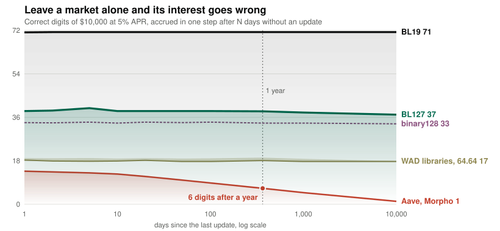

# Blockulator

<!-- badges:begin -->
[](https://github.com/securedataresearch/blockulator/actions/workflows/ci.yml) [](docs/proofs.md) [](test) [](docs/benchmarks/wad.md) [](LICENSE)
<!-- badges:end -->

**Exact math for real money.** FP127 and FP256 put precision maths in one `int256`: 38 digits and 71, every op correctly rounded, checked on chain, and now competitive on gas. When the amounts are large or the call is free, they are the only choice. [blockulator.com](https://blockulator.com)

<picture>
  <source media="(prefers-color-scheme: dark)" srcset="docs/img/digits-dark.svg">
  
</picture>

| | what it is | precision | range |
|---|---|---|---|
| **FP256** | 256-bit binary float | 71 digits, everywhere | 10^±78,913 |
| **FP127** | signed 127.128 fixed point | 38 digits at 1 | money-sized numbers |

## Correct to the last wei

<!-- wad:begin -->
Results off by at least one wei, against the exact value rounded in each library's own direction, on the same seeded inputs. BlockulatorWad keeps Solady's names and is wrong on **0 of 108,000** results across 27 functions and rounding directions.

| function | **BlockulatorWad** | Solady | PRBMath |
|---|---:|---:|---:|
| `expWad` | **0 of 3,995** | 1,918 of 3,994 (48%) | 2,863 of 3,976 (72%) |
| `lnWad` | **0 of 3,998** | 957 of 3,998 (24%) | 3,907 of 3,998 (98%) |
| `log2Wad` | **0 of 3,998** | — | 3,704 of 3,998 (93%) |
| `log10Wad` | **0 of 3,998** | — | 3,532 of 3,998 (88%) |
| `powWad` | **0 of 3,461** | 2,243 of 3,380 (66%) | 2,439 of 3,415 (71%) |
| `lambertW0Wad` | **0 of 3,999** | 1,129 of 3,999 (28%) | — |

Where they offer them, Solady and PRBMath are exact too on `cbrtWad`, `divWad`, `divWadUp`, `mulWad`, `mulWadUp`, `sDivWad`, `sMulWad`, `sqrtWad`. Versions: BlockulatorWad 9070a12, Solady FixedPointMathLib v0.1.26, PRBMath (UD60x18 / SD59x18) v4.2.0; full table in [`wad.md`](docs/benchmarks/wad.md).
<!-- wad:end -->

## Twice the digits, at the same gas

<!-- gas:begin -->
| | digits | add | mul | div | exp<sup>t</sup> | ln<sup>t</sup> | pow<sup>t</sup> | sqrt<sup>t</sup> |
|---|---:|---:|---:|---:|---:|---:|---:|---:|
| **FP256** | **71** | **662** | **530** | **800** | **3,278** | **3,043** | **5,901** | **1,205** |
| **FP127** | **38** | **128** | **267** | **412** | **2,716** | **1,944** | **3,317** | **683** |
| ABDKMathQuad | 34 | 734 | 709 | 818 | 5,668 | 16,356 | 23,467 | 760 |
| PRBMath SD59x18 | 18 | 189 | 485 | 509 | 2,816 | 7,083 | 10,065 | 978 |
| Solady | 18 | 3 | 126 | 93 | 430 | 556 | 1,279 | 393 |

Median gas per inline call, over random inputs that take no shortcut (<sup>t</sup>) or the op's input ladder; digits are precision at 1. FP256 is cheaper than ABDKMathQuad on `add`, `mul`, `div`, `exp`, `ln` and `pow`, not `sqrt`; FP127 is cheaper than PRBMath on every op here. Over these 7 ops FP256 carries 2.1× Quad's digits at 32% of its mean gas, FP127 2.1× PRBMath's at 43%. Solady is the cheapest, at 18 digits; its `add` is the unchecked `rawAdd`.
<!-- gas:end -->

Every op and library: [`gas.md`](docs/benchmarks/gas.md), [`gas256.md`](docs/benchmarks/gas256.md). Compile with `via_ir = true`; it takes another 10–33% off the inline libraries.

## Install

```bash
forge install securedataresearch/blockulator
echo "fp127/=lib/blockulator/contracts/src/fp127/" >> remappings.txt
echo "fp256/=lib/blockulator/contracts/src/fp256/" >> remappings.txt
```

```solidity
import {FP127Lib} from "fp127/FP127Lib.sol";
import {FP256Lib} from "fp256/FP256Lib.sol";

int256 grown = FP256Lib.pow(FP256Lib.add(FP256Lib.ONE, rate), FP256Lib.fromUint(31536000));
uint256 paid = FP256Lib.toUintDown(grown);          // to the user: floor
int256  ltv  = FP127Lib.divUp(debt, collateral);    // a limit check: never below the truth
```

Or call the deployed contracts, where every op is a free `eth_call`: `IFP127(0xb349…CBe4).ln(x)`. Agents can start from [`/llms.txt`](https://blockulator.com/llms.txt).

**Requires the CLZ opcode** (EIP-7939, the Osaka EVM). Supported: Ethereum, Arbitrum, OP Mainnet, Base, Unichain, Polygon PoS, BNB Chain, Gnosis, Scroll, Linea. Not supported: zkSync Era, Avalanche C-Chain. Check any chain with `make probe-clz RPC=<url>`.

## Two rules that end dust

Each rule comes from replaying a real exploit bit for bit, then running the same step in FP127, FP256 and exact arithmetic ([replays](docs/benchmarks/README.md)).

1. **Store the state in the format.** Keep running balances as FP127 or FP256 words, and round to token units only on the way out. In Bunni v2's replay this alone turns a balance drained from 28 wei to 4 into 35.6 wei, within 10^−37 of exact.
2. **Round toward the protocol at the token edge.** Floor what you pay out and ceil what you take in, never to nearest. Under this rule Resupply's borrow against 1 wei of collateral reverts, and Balancer V2's charge matches the exact one on every call.

The [integration guide](https://blockulator.com/library/#integrating) has the worked examples and the edge-op table.

## Blockulator 2.2 on Sepolia

| contract | address |
|---|---|
| FP127 v6 | `0xb349DB36D51b0BC10Dd43aF70009b7B6E7c1CBe4` |
| FP256 (the number) | `0xAa1f71B7B08d568379b28E1488c6B737a1C6eb52` |
| FP256E (exp, log, pow) | `0x017F68A57dD53a6dF2043c24B712b287F9549AE2` |
| FP256H (hyperbolic) | `0xEfefa2B63A173d56F9db79C5dd8A607F4aA859A5` |
| FP256S (erf, Lambert W) | `0x73E8809F163d4358773cc5F25c134997B4b842F4` |

Every contract is verified on Sourcify and Blockscout. Each library is one Yul source that generates both the deployed object and the inline library, fuzzed to agree bit for bit. More detail: [records](contracts/deployments/RELEASE.md), [FP127](contracts/src/fp127/README.md), [FP256](contracts/src/fp256/README.md), [precision](docs/fp256/precision.md), [the ladder](docs/benchmarks/ladder.md), [the edges](docs/benchmarks/edges.md), [proofs](docs/proofs.md), [changelog](CHANGELOG.md).

## Learn more

- [The write-up](https://blockulator.com/writeup/): the story, with sources.
- ["Dust is Over"](docs/talks/outline.md): the talk.
- [Developing](docs/DEVELOPING.md): layout, build, `make gates`. The tables and chart above are `make readme-assets`.
- [History](docs/fp127/HISTORY.md), and the [EthCC[9] talk](https://www.youtube.com/watch?v=a_tL99NY-yc) from the Huff era.

MIT licensed: FP127, FP256 and BlockulatorWad never import AGPL code. Three benchmark-only files link the AGPL-3.0 Solmate and snekmate libraries and carry that licence: `LadderSolmate.sol`, `SnekmateMath.vy` and `test/fp127/GasLibs.sol` ([details](contracts/src/ladder/vendor/README.md)). [Security](SECURITY.md).
