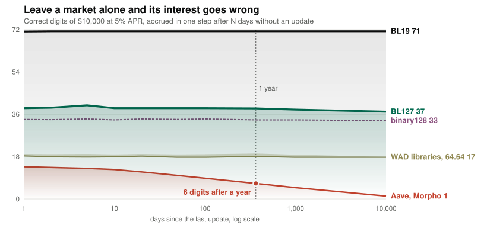

# Blockulator

<!-- badges:begin -->
[](https://github.com/securedataresearch/blockulator/actions/workflows/ci.yml) [](docs/proofs.md) [](test) [](LICENSE)
<!-- badges:end -->

**Blockulator is the definitive source for mathematical precision on the EVM.** It is two libraries, and each holds a number in one `int256`: BL127 keeps 38 digits of fixed point with every op correctly rounded, and BL19 keeps 71 digits of float with every op correctly rounded or exact. Both are checked on chain and competitive on gas. When the amounts are large or the call is free, they are the only choice. [blockulator.com](https://blockulator.com)

On typical inputs BL127's ln and pow cost 1,944 and 3,316 gas against PRBMath's 7,022 and 10,020, with 38 digits against 18; exp costs about the same, 2,834 against 2,844. BL19's ln and pow cost 3,100 and 5,940 against ABDKMathQuad's 16,388 and 23,406, with 71 digits against 34; ABDKMathQuad's sqrt is cheaper, 760 against 1,203. Across the 326 live accruals at the survey block (252 Morpho markets and 74 Aave reserve sides), the deployed accrual keeps a median 7.2 correct digits of the pending interest; BL127 keeps 30 and BL19 67.

<picture>
  <source media="(prefers-color-scheme: dark)" srcset="docs/img/digits-dark.svg">
  
</picture>

| | what it is | precision | range |
|---|---|---|---|
| **BL19** | 256-bit binary float | 71 digits, everywhere | 10^±78,913 |
| **BL127** | signed 127.128 fixed point | 38 digits at 1 | money-sized numbers |

## Twice the digits, at the same gas

<!-- gas:begin -->
| | digits | add | mul | div | exp<sup>t</sup> | ln<sup>t</sup> | pow<sup>t</sup> | sqrt<sup>t</sup> |
|---|---:|---:|---:|---:|---:|---:|---:|---:|
| *floating point* | | | | | | | | |
| **BL19** | **71** | **650** | **530** | **804** | **3,300** | **3,100** | **5,940** | **1,203** |
| ABDKMathQuad | 34 | 734 | 709 | 818 | 5,806 | 16,388 | 23,406 | 760 |
| *fixed point* | | | | | | | | |
| **BL127** | **38** | **128** | **267** | **413** | **2,834** | **1,944** | **3,316** | **815** |
| ABDKMath64x64 | 19 | 162 | 171 | 221 | 3,373 | 7,091 |  | 822 |
| PRBMath SD59x18 | 18 | 189 | 485 | 509 | 2,844 | 7,022 | 10,020 | 986 |
| PRBMath UD60x18 | 18 | 150 | 237 | 261 | 2,671 | 6,459 | 9,326 | 832 |
| Solady | 18 | 3 | 126 | 93 | 430 | 556 | 1,279 | 393 |
| Solmate | 18 |  | 131 | 97 | 430 | 632 | 1,355 | 456 |
| Balancer LogExpMath | 18 |  |  |  | 1,062 | 1,135 | 2,237 | 2,381 |
| snekmate | 18 |  |  |  | 604 | 1,253 |  |  |
| OpenZeppelin Math | 18 |  |  |  |  |  |  | 769 |

Median gas per inline call, over 100 random inputs that take no shortcut (<sup>t</sup>) or the op's input ladder, good to about 1 or 2 percent; digits are precision at 1. BL19 is cheaper than ABDKMathQuad on `add`, `mul`, `exp`, `ln` and `pow`, about the same on `div`, and dearer on `sqrt`, and over these 7 ops carries 2.1× its digits at 32% of its mean gas. BL127 carries twice the digits of every fixed-point library here. It is cheaper than ABDKMath64x64 on `add`, `exp` and `ln`, about the same on `sqrt`, and dearer on `mul` and `div`. It is cheaper than PRBMath SD59x18 on `add`, `mul`, `div`, `ln`, `pow` and `sqrt`, about the same on `exp`. It is cheaper than PRBMath UD60x18 on `add`, `ln`, `pow` and `sqrt`, and dearer on `mul`, `div` and `exp`. Solady, Solmate, Balancer LogExpMath, snekmate and OpenZeppelin Math are cheaper on most ops, at 18 digits; Solady's `add` is the unchecked `rawAdd`.
<!-- gas:end -->

Every op and library: [`gas.md`](docs/benchmarks/gas.md), [`gas19.md`](docs/benchmarks/gas19.md). Compile with `via_ir = true`; it takes another 8–31% off the inline libraries.

## Install

One import path, three ways in:

```bash
# Foundry, from git
forge install securedataresearch/blockulator
echo "@blockulator/contracts/=lib/blockulator/contracts/src/" >> remappings.txt

# npm, yarn or pnpm: Hardhat needs no remapping; Foundry reading node_modules needs this one
npm install @blockulator/contracts
echo "@blockulator/contracts/=node_modules/@blockulator/contracts/" >> remappings.txt

# Soldeer
forge soldeer install blockulator~<version>
echo "@blockulator/contracts/=dependencies/blockulator-<version>/" >> remappings.txt
```

```solidity
import {BL127Lib} from "@blockulator/contracts/bl127/BL127Lib.sol";
import {BL19Lib} from "@blockulator/contracts/bl19/BL19Lib.sol";

int256 grown = BL19Lib.pow(BL19Lib.add(BL19Lib.ONE, rate), BL19Lib.fromUint(31536000));
uint256 paid = BL19Lib.toUintDown(grown);          // to the user: floor
int256  ltv  = BL127Lib.divUp(debt, collateral);    // a limit check: never below the truth
```

Or call the deployed contracts, where every op is a free `eth_call`: `IBL127E(0xc16F…0808).ln(x)`. Agents can start from [`/llms.txt`](https://blockulator.com/llms.txt).

**Requires the CLZ opcode** (EIP-7939, the Osaka EVM). Supported: Ethereum, Arbitrum One, OP Mainnet, Base, Unichain, Polygon PoS, BNB Chain and Gnosis; Scroll and Linea by a live probe of the opcode ([the list](contracts/deployments/README.md#chains-clz-osaka-required)). Not supported: zkSync Era, Avalanche C-Chain, Polygon zkEVM. Check any chain with `make probe-clz RPC=<url>`.

## Two rules that end dust

Each rule comes from replaying a real exploit bit for bit, then running the same step in BL127, BL19 and exact arithmetic ([replays](docs/benchmarks/README.md)).

1. **Store the state in the format.** Keep running balances as BL127 or BL19 words, and round to token units only on the way out. In Bunni v2's replay this alone turns a balance drained from 28 wei to 4 into 35.6 wei, within 10^−37 of exact.
2. **Round toward the protocol at the token edge.** Floor what you pay out and ceil what you take in, never to nearest. Under this rule Resupply's borrow against 1 wei of collateral reverts, and Balancer V2's charge matches the exact one on every call.

The [integration guide](https://blockulator.com/library/#integrating) has the worked examples and the edge-op table.

## Blockulator 3.0 on Sepolia

| contract | address |
|---|---|
| BL127 (the number) | `0x0DF738d125677550a80A46BaF254386C66f96E0d` |
| BL127E (exp, log, pow) | `0xc16F4C45B78D90A4D4C030cABF4f2A34c1Fb0808` |
| BL127H (hyperbolic) | `0xf2F99947aD1cC370bD5388a2997A5E4963a0B27B` |
| BL127N (erf, normCdf) | `0xAA7Cd9635aE8630379636F533f23DBf2C193d296` |
| BL127S (Lambert W) | `0xB9C2583a7Ad2251444DC7752658B6C1107C25036` |
| BL19 (the number) | `0x94d9d43D6202827429a8058959eeCf6d232b8729` |
| BL19E (exp, log, pow) | `0x8e5eE786bDD7c35a2867Fd329441d0BD0fB61092` |
| BL19H (hyperbolic) | `0xF059611C1c42543DE6EE82353Eb082Fd8999081f` |
| BL19N (erf, normCdf) | `0xCe9F09D646B37a9100F05ED1FFD14E9f43180214` |
| BL19S (Lambert W) | `0xf74ba90535224870830e6e89D2b328d4cc09DE48` |

Every contract is verified on Sourcify and Blockscout. Each library is one Yul source that generates both the deployed object and the inline library, fuzzed to agree bit for bit. More detail: [records](contracts/deployments/RELEASE.md), [BL127](contracts/src/bl127/README.md), [BL19](contracts/src/bl19/README.md), [precision](docs/bl19/precision.md), [the ladder](docs/benchmarks/ladder.md), [the edges](docs/benchmarks/edges.md), [proofs](docs/proofs.md), [changelog](CHANGELOG.md).

## How we know

- **Proved for every input.** 35 core ops, 17 of BL127's 19 and 18 of BL19's 24, return exactly the word an independent specification returns, on every input: Halmos executes the compiled inline library symbolically, and the specification's integer primitives are proved as separate lemmas (BL127's `sqrt` rests on one, [`isqrt.py`](test/proofs/isqrt.py)). The other eight are fuzzed, not proved: BL127's `gavg` and `hypot`, BL19's `add`, `sub`, `sqrt`, `toFixed18`, `toFixed18Down` and `toFixed18Up`. `make proofs`; [`docs/proofs.md`](docs/proofs.md).
- **Swept.** 116,386 results over 32 BL127 ops and 340,394 over 53 BL19 ops, from seeded random inputs, against the correctly rounded result: none misrounded. The ops with a fast path are swept again with it forced to fail, so the later stages answer alone (27 more BL127 rows, 23 more BL19 rows): none misrounded. `make sweep`; [`sweep.md`](docs/benchmarks/sweep.md).
- **Reproducible.** The tables and charts here and on the site are generated from the datasets in [`docs/benchmarks/`](docs/benchmarks/), each by a `make` target; `make gates` reruns the checks a merge needs. Numbers typed into a page's text are not checked by a script.
- **Not done.** No third party has audited the libraries, and they are deployed on Sepolia only, not on Ethereum mainnet.

## Learn more

- [The write-up](https://blockulator.com/writeup/): the story, with sources.
- ["Dust is Over"](docs/talks/outline.md): the talk.
- [Developing](docs/DEVELOPING.md): layout, build, `make gates`. The tables and chart above are `make readme-assets`.
- [History](docs/bl127/HISTORY.md), and the [EthCC[9] talk](https://www.youtube.com/watch?v=a_tL99NY-yc) from the Huff era.

MIT licensed: BL127 and BL19 never import AGPL code. Three benchmark-only files link the AGPL-3.0 Solmate and snekmate libraries and carry that licence: `LadderSolmate.sol`, `SnekmateMath.vy` and `test/bl127/GasLibs.sol` ([details](contracts/src/ladder/vendor/README.md)). [Security](SECURITY.md).
